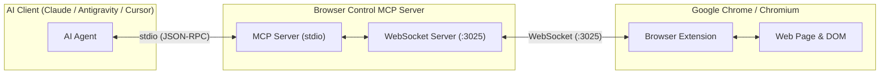

# 🌐 Browser Control MCP (Model Context Protocol) + Chrome Extension

A bridge connecting **AI Agents** (Claude Desktop, Antigravity, Cursor, Windsurf, etc.) directly to Chromium-based browsers (Google Chrome, Brave, Edge, Arc) via a **Browser Extension (Manifest V3)** and an **MCP Server**.

This architecture empowers AI to:
- 🚀 **Control your real browser session**: Leverage your existing logins (Google, GitHub, Jira, Intranet, etc.), cookies, and local session state without triggering anti-bot protections or CAPTCHAs.
- 📖 **Read & extract clean page content**: Automatically strip ads, cookie banners, navigation menus, and convert rich HTML into clean, well-structured Markdown.
- 💾 **Export web content to Markdown (`.md`) files**: Seamlessly save research, documentation, or articles directly to the local `exports/` directory.
- 🖱️ **Interact with web elements**: Automatically scan interactive elements (buttons, links, inputs), click targets, type into fields (with full React/Vue/Angular synthetic event support), scroll, and send keystrokes.
- 📸 **Capture screenshots**: Take visual screenshots of the active browser tab and save as PNG.

---

## 🏗️ Architecture



---

## 🛠️ Quick Setup (3 Steps)

### Step 1: Build the MCP Server
Inside the project directory (`browser_ctl_mcp`):
```bash
npm install
npm run build
```

### Step 2: Install Extension in Chrome
1. Open Google Chrome (or Brave, Edge, Arc).
2. Navigate to: `chrome://extensions/`
3. Enable the **"Developer mode"** toggle in the top-right corner.
4. Click **"Load unpacked"**.
5. Select the `extension` folder located in this repository:
   ```
   /Users/nph/Desktop/personal/browser_ctl_mcp/extension
   ```
6. Pin the **Browser Control MCP Bridge** extension to your browser toolbar.
7. Once the MCP Server is running, the badge will show a green `ON` indicator.

---

### Step 3: Configure MCP in your AI Client

#### 1. For Claude Desktop
Open your Claude Desktop configuration file:
- **macOS**: `~/Library/Application Support/Claude/claude_desktop_config.json`
- **Windows**: `%APPDATA%\Claude\claude_desktop_config.json`

Add the following to `mcpServers`:

```json
{
  "mcpServers": {
    "browser-ctl": {
      "command": "node",
      "args": [
        "/Users/nph/Desktop/personal/browser_ctl_mcp/dist/server/src/index.js"
      ],
      "env": {
        "BROWSER_MCP_PORT": "3025"
      }
    }
  }
}
```

#### 2. For Antigravity / Cursor / Windsurf
Add to your workspace or user MCP configuration (`mcp.json` or IDE MCP settings):
```json
{
  "browser-ctl": {
    "command": "node",
    "args": [
      "/Users/nph/Desktop/personal/browser_ctl_mcp/dist/server/src/index.js"
    ]
  }
}
```

---

## 🧰 Available MCP Tools

| Tool Name | Description |
| :--- | :--- |
| `browser_get_status` | Check extension connection status, active tab details, and all open tabs. |
| `browser_open_url` | Navigate the active tab or open a new tab with a specified URL. |
| `browser_read_page` | Extract page content as clean `markdown` (default), plain `text`, or `html`. Intelligently isolates primary article body. |
| `browser_export_markdown` | **Extract webpage content as Markdown and save directly to a `.md` file** in `./exports/` or a custom path. |
| `browser_get_interactive_elements` | Scan page for interactive elements (buttons, links, inputs) with index, text, CSS selector, and visibility. |
| `browser_click` | Click an element by CSS selector, visible text, or numeric `elementIndex`. |
| `browser_fill_input` | Fill text into an input field or textarea. Supports React/Vue synthetic events and optional Enter key press. |
| `browser_press_key` | Dispatch keyboard keys (`Enter`, `Tab`, `Escape`, `ArrowDown`, etc.). |
| `browser_scroll` | Scroll page (`down`, `up`, `top`, `bottom`) with custom pixel distance. |
| `browser_evaluate_js` | Execute custom JavaScript in page context and return the serialized result. |
| `browser_screenshot` | Capture visual screenshot of the current tab and save as PNG. |

---

## 💡 Example Prompts for AI Agents

Once configured, you can interact with your AI naturally:

1. **Collect & Export Research to Markdown**:
   > *"Read the article currently open on my browser tab and export it as a Markdown file into the exports folder."*
   > → AI invokes `browser_export_markdown` and returns the saved file path.

2. **Automate Web Search & Navigation**:
   > *"Navigate to https://news.ycombinator.com, find the first article about AI, click it, and summarize the key takeaways."*
   > → AI opens the URL, inspects interactive elements with `browser_get_interactive_elements`, clicks the link with `browser_click`, and reads content via `browser_read_page`.

3. **Fill Forms & Search**:
   > *"Find the search input on the active page, type 'Model Context Protocol', and press Enter."*
   > → AI executes `browser_fill_input` with `{ value: "Model Context Protocol", pressEnter: true }`.

---

## 📁 Repository Structure

```
browser_ctl_mcp/
├── server/
│   ├── src/
│   │   ├── index.ts          # MCP Server entrypoint (stdio transport & tool handlers)
│   │   ├── wsServer.ts       # WebSocket server bridging to Chrome extension (:3025)
│   │   ├── types.ts          # TypeScript type definitions
│   │   └── utils/
│   │       └── fileExport.ts # Markdown file saving utilities
├── extension/
│   ├── manifest.json         # Manifest V3 extension configuration
│   ├── background.js         # Service worker managing WebSocket and tabs
│   ├── content.js            # In-page DOM engine: Markdown extraction, clicks, input
│   ├── popup.html            # Extension popup user interface
│   ├── popup.css
│   ├── popup.js
│   └── icons/                # Extension icons (16x16, 48x48, 128x128)
├── exports/                  # Directory where exported Markdown files are saved
├── test/
│   └── mock_extension_test.ts# Automated end-to-end integration test
├── package.json
└── tsconfig.json
```

---

## 🔒 Security & Privacy
- The MCP WebSocket server binds strictly to `127.0.0.1` (localhost) and is not exposed to external networks.
- All browser interactions and extracted contents remain purely local between your browser and local AI client.
- No telemetry, analytics, or third-party cloud services are involved.
