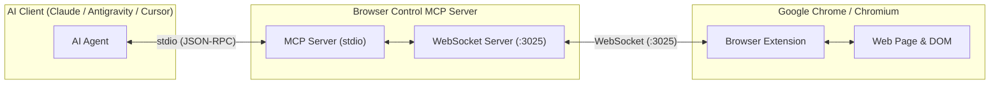

# 🌐 Browser Control MCP (Model Context Protocol) + Chrome Extension

Dự án kết nối trực tiếp các **AI Agent** (Claude Desktop, Antigravity, Cursor, Windsurf, v.v.) với trình duyệt Google Chrome / Chromium thông qua một **Browser Extension (Manifest V3)** và **MCP Server**.

Giải pháp này cho phép AI:
- 🚀 **Điều khiển trực tiếp trình duyệt cá nhân**: Tận dụng các phiên đăng nhập (Google, Facebook, GitHub, Jira, Intranet...), cookie, xác thực có sẵn của bạn mà không lo bị chặn bot hay Captcha.
- 📖 **Đọc & trích xuất nội dung bài viết**: Tự động lọc sạch quảng cáo, menu rác và chuyển đổi HTML thành Markdown chuẩn.
- 💾 **Tự động lưu nội dung thành file `.md`**: Xuất toàn bộ bài viết, tài liệu nghiên cứu trực tiếp về thư mục `exports/` trong máy tính.
- 🖱️ **Tương tác thông minh**: Quét danh sách phần tử tương tác (nút bấm, ô input, liên kết), tự động click, điền biểu mẫu (hỗ trợ cả React/Vue/Angular synthetic events), cuộn trang, nhấn phím bàn phím.
- 📸 **Chụp ảnh màn hình**: Chụp lại trang web đang duyệt và lưu ảnh PNG.

---

## 🏗️ Kiến trúc hệ thống



---

## 🛠️ Hướng dẫn cài đặt nhanh (3 bước)

### Bước 1: Build MCP Server
Trong thư mục dự án (`browser_ctl_mcp`):
```bash
npm install
npm run build
```

### Bước 2: Cài Extension vào Chrome
1. Mở trình duyệt Chrome (hoặc Brave, Edge, Cốc Cốc, Arc).
2. Truy cập vào: `chrome://extensions/`
3. Bật công tắc **"Developer mode"** (Chế độ cho nhà phát triển) ở góc trên bên phải.
4. Bấm nút **"Load unpacked"** (Tải tiện ích đã giải nén).
5. Chọn thư mục `extension` nằm trong dự án:
   ```
   /Users/nph/Desktop/personal/browser_ctl_mcp/extension
   ```
6. Bạn sẽ thấy biểu tượng tiện ích **Browser Control MCP Bridge** xuất hiện. Hãy ghim nó lên thanh công cụ của trình duyệt.
7. Khi MCP Server chạy, huy hiệu trên icon sẽ chuyển sang màu xanh lá cây `ON` (Connected).

---

### Bước 3: Cấu hình MCP Server vào AI Client

#### 1. Dành cho Claude Desktop
Mở file cấu hình Claude Desktop:
- **macOS**: `~/Library/Application Support/Claude/claude_desktop_config.json`
- **Windows**: `%APPDATA%\Claude\claude_desktop_config.json`

Thêm cấu hình sau vào mục `mcpServers`:

```json
{
  "mcpServers": {
    "browser-ctl": {
      "command": "node",
      "args": [
        "/Users/nph/Desktop/personal/browser_ctl_mcp/dist/server/src/index.js"
      ],
      "env": {
        "BROWSER_MCP_PORT": "3025"
      }
    }
  }
}
```

#### 2. Dành cho Antigravity / Cursor / Windsurf
Cấu hình tương tự trong file settings MCP (`mcp.json` hoặc UI settings):
```json
{
  "browser-ctl": {
    "command": "node",
    "args": [
      "/Users/nph/Desktop/personal/browser_ctl_mcp/dist/server/src/index.js"
    ]
  }
}
```

---

## 🧰 Danh sách các Tool AI Agent có thể sử dụng

| Tên Tool | Mô tả |
| :--- | :--- |
| `browser_get_status` | Kiểm tra kết nối với Extension, lấy danh sách tab và thông tin tab đang mở. |
| `browser_open_url` | Mở URL mới hoặc điều hướng tab hiện tại đến địa chỉ mong muốn. |
| `browser_read_page` | Đọc nội dung trang hiện tại dạng `markdown` (mặc định), `text`, hoặc `html`. Tự động nhận diện bài viết chính. |
| `browser_export_markdown` | **Thu thập & trích xuất nội dung trang thành file `.md`** lưu vào thư mục `exports/` hoặc đường dẫn do AI chỉ định. |
| `browser_get_interactive_elements` | Quét toàn bộ nút bấm, link, ô nhập liệu trên trang kèm chỉ số index, text, CSS selector và tọa độ. |
| `browser_click` | Click vào phần tử bằng CSS selector, từ khóa văn bản (`text`), hoặc số thứ tự `elementIndex`. |
| `browser_fill_input` | Gõ văn bản vào ô input/textarea. Hỗ trợ React synthetic event và tùy chọn tự động bấm Enter. |
| `browser_press_key` | Nhấn phím bàn phím (`Enter`, `Tab`, `Escape`, `ArrowDown`, ...). |
| `browser_scroll` | Cuộn trang (`down`, `up`, `top`, `bottom`) với khoảng cách tùy chọn. |
| `browser_evaluate_js` | Thực thi mã JavaScript tùy biến trực tiếp trên trang web và trả về kết quả JSON. |
| `browser_screenshot` | Chụp ảnh màn hình tab hiện tại và lưu thành file `.png`. |

---

## 💡 Ví dụ câu lệnh mẫu để yêu cầu AI Agent

Sau khi cài đặt xong, bạn có thể ra lệnh cho AI trong khung chat:

1. **Thu thập tài liệu sang file Markdown**:
   > *"Đọc bài viết đang mở trên trình duyệt của tôi và xuất thành file Markdown vào thư mục exports."*
   > → AI sẽ gọi `browser_export_markdown` và báo cho bạn file `.md` vừa tạo.

2. **Tự động tìm kiếm và điều khiển web**:
   > *"Hãy mở trang https://news.ycombinator.com, tìm bài viết đầu tiên nói về AI và click vào đọc, sau đó tóm tắt lại cho tôi."*
   > → AI sẽ mở URL, quét link bài viết bằng `browser_get_interactive_elements`, click vào và đọc nội dung bằng `browser_read_page`.

3. **Điền form & đăng nhập**:
   > *"Tìm ô tìm kiếm trên trang đang mở, nhập từ khóa 'Deep Learning' rồi bấm Enter."*
   > → AI sẽ gọi `browser_fill_input` với `{ value: "Deep Learning", pressEnter: true }`.

---

## 📁 Cấu trúc thư mục

```
browser_ctl_mcp/
├── server/
│   ├── src/
│   │   ├── index.ts        # Entrypoint MCP Server (stdio transport & tool handlers)
│   │   ├── wsServer.ts     # WebSocket server kết nối extension (:3025)
│   │   ├── types.ts        # Types & Interfaces
│   │   └── utils/
│   │       └── fileExport.ts # Tiện ích lưu Markdown file vào disk
├── extension/
│   ├── manifest.json       # Manifest V3 cấu hình Extension
│   ├── background.js       # Service worker quản lý WebSocket & Tab
│   ├── content.js          # In-page engine: trích xuất Markdown, click, fill input
│   ├── popup.html          # Giao diện popup tiện ích
│   ├── popup.css
│   ├── popup.js
│   └── icons/              # Icon tiện ích (16, 48, 128)
├── exports/                # Thư mục chứa các file .md được AI thu thập
├── test/
│   └── mock_extension_test.ts # Script kiểm thử tự động
├── package.json
└── tsconfig.json
```

---

## 🔒 An toàn & Bảo mật
- MCP Server chỉ lắng nghe tại `127.0.0.1` (localhost), không mở ra mạng ngoài.
- Toàn bộ dữ liệu truyền nhận nội bộ giữa trình duyệt của bạn và AI Agent chạy trên máy tính cá nhân.
- Không gửi bất kỳ dữ liệu nào lên server bên thứ ba ngoài máy tính của bạn.
